# STRUT: Node.js E-commerce App with a Dockerized Jenkins CI/CD Pipeline on AWS EC2


A full CI/CD pipeline for a Node.js web application. Every push to `main` is picked up by Jenkins, tested with Jest, packaged into a Docker image, and deployed as a container on an AWS EC2 instance, with no manual steps in between.

The app itself is **STRUT**, a men's accessories storefront (68 products across 7 categories) built with Express and vanilla JavaScript.

> **Live demo:** _add your URL here_ &nbsp;|&nbsp; **Pipeline walkthrough:** _optional: add a short Loom/YouTube link_

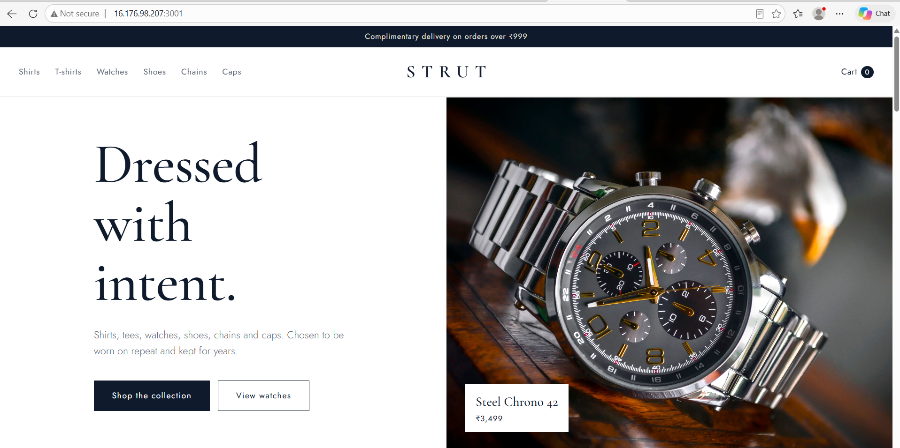

---

## Table of contents

- [What this project demonstrates](#what-this-project-demonstrates)
- [Architecture](#architecture)
- [Screenshots](#screenshots)
- [Tech stack](#tech-stack)
- [CI/CD pipeline](#cicd-pipeline)
- [Application features](#application-features)
- [API reference](#api-reference)
- [Project structure](#project-structure)
- [Run locally](#run-locally)
- [Run with Docker](#run-with-docker)
- [Set up the pipeline on EC2](#set-up-the-pipeline-on-ec2)
- [Security notes](#security-notes)
- [Troubleshooting](#troubleshooting)
- [Roadmap](#roadmap)

---

## What this project demonstrates

| Skill | How it shows up here |
|---|---|
| CI/CD design | Declarative Jenkins pipeline (`Jenkinsfile`) with Install, Test, Build, Deploy stages |
| Containerization | Dockerfile on `node:18-alpine`, layer caching, non-root user, health check |
| Cloud / infrastructure | Jenkins and the app host run on AWS EC2, with Security Group rules scoped to specific ports |
| Automated testing | Jest + Supertest tests gate every deployment; a failing test stops the pipeline |
| Pipeline as code | The `Jenkinsfile` lives in the repo and is versioned with the application |
| Operational hygiene | `/health` endpoint, `--restart unless-stopped`, idempotent redeploys |
| Debugging | See [Troubleshooting](#troubleshooting) for real issues hit and fixed while building this |

## Architecture

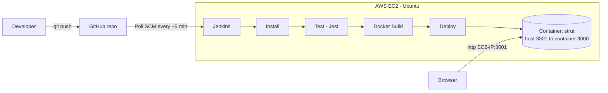

## Screenshots

Everything below was captured from the real deployment on AWS EC2, not from a local machine.

### 1. Homepage, live on AWS EC2

**What this shows:** The STRUT storefront opened in a browser through the EC2 instance's public IP on port 3001. The page is served by the Express app running inside a Docker container.

**Why it matters:** It proves the whole chain works: code on GitHub, built by Jenkins, running in Docker, reachable from the internet.


### 2. Product catalogue

**What this shows:** The product grid with a category filter applied. Product data is fetched from the `/api/products` endpoint of the Express server and rendered in the browser.

**Why it matters:** It shows the application side of the project: a working REST endpoint feeding a responsive frontend.

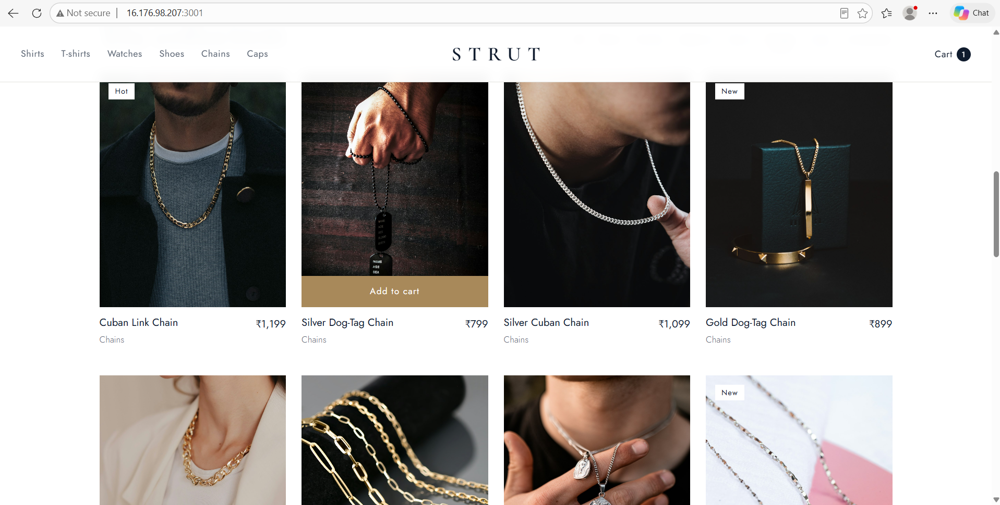

### 3. Shopping cart

**What this shows:** The cart drawer with items added, quantity controls and a running total, all handled in vanilla JavaScript.

**Why it matters:** It demonstrates client-side state handling without any frontend framework.

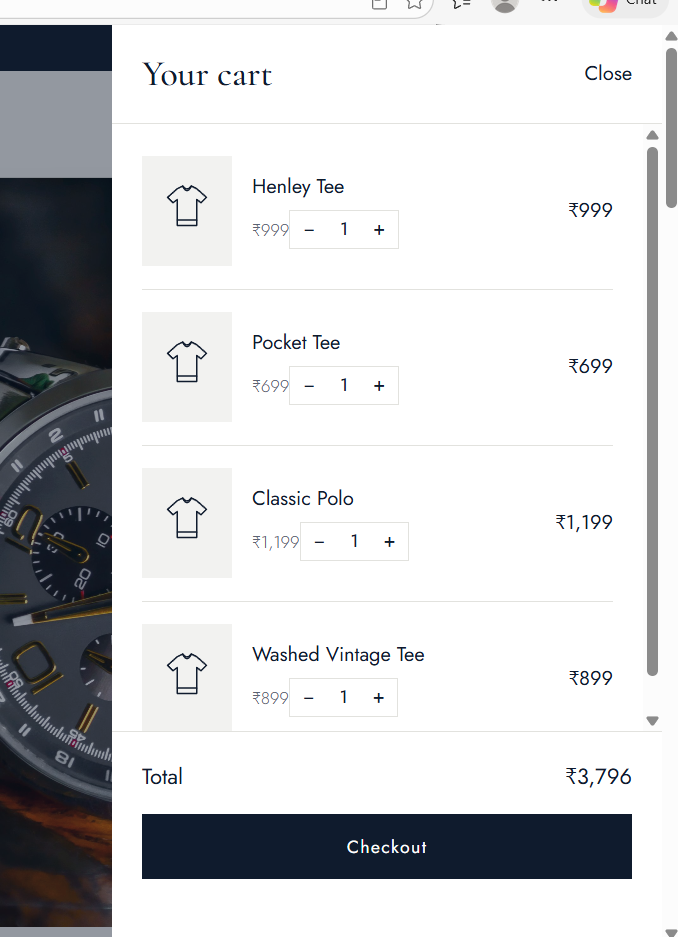

### 4. Jenkins pipeline stage view

**What this shows:** A single successful build (#12) with every stage passing in green: Checkout SCM, Tool Install, Install, Test, Docker Build and Deploy. The Deploy stage is expanded and shows the exact `docker run` command Jenkins executed.

**Why it matters:** This is the main proof of CI/CD. Each commit goes through the same automated stages, and any failure stops the deployment.


### 4b. Build history: failures and fixes

**What this shows:** The job's build history. Builds #1 to #4 failed (red) while I fixed a missing `package-lock.json`, a Dockerfile `npm ci` error and a port conflict on the server. Builds #5 onwards pass every stage (green) from checkout to deploy.

**Why it matters:** It shows the real debugging process behind the pipeline, not just the final result. The failed stages stop the pipeline early, which is exactly what a CI/CD gate should do. The fixes are documented in the [Troubleshooting](#troubleshooting) section.

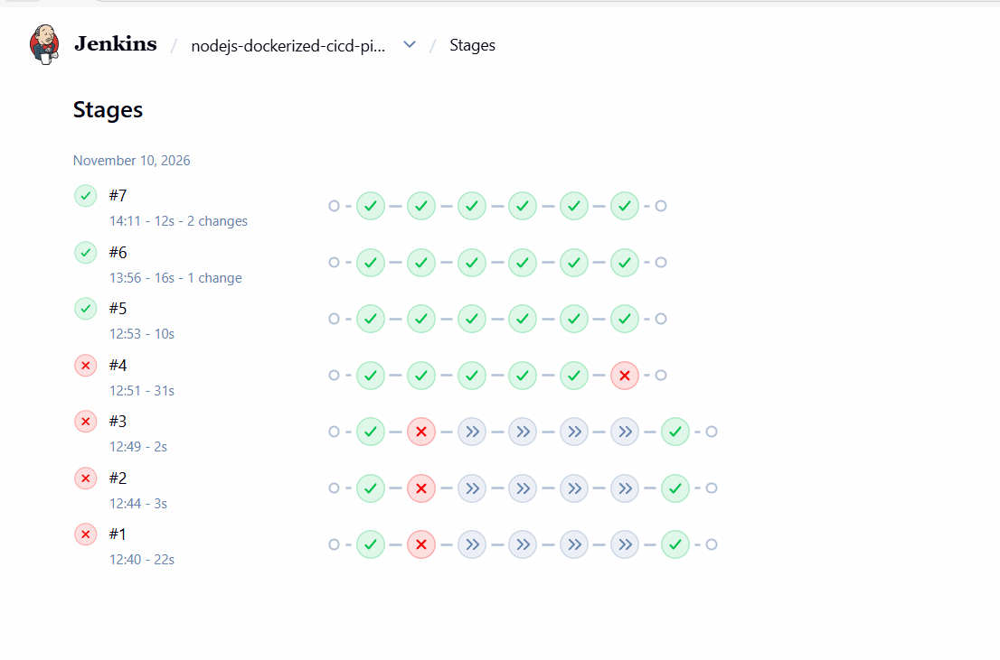

### 5. Jenkins job configuration

**What this shows:** The Pipeline section of the job: Definition set to *Pipeline script from SCM*, Git as the SCM, this repository as the source, branch `main`, and `Jenkinsfile` as the script path.

**Why it matters:** It shows the pipeline is defined as code in the repository. Changing the pipeline means committing to Git, not clicking around in the Jenkins UI.

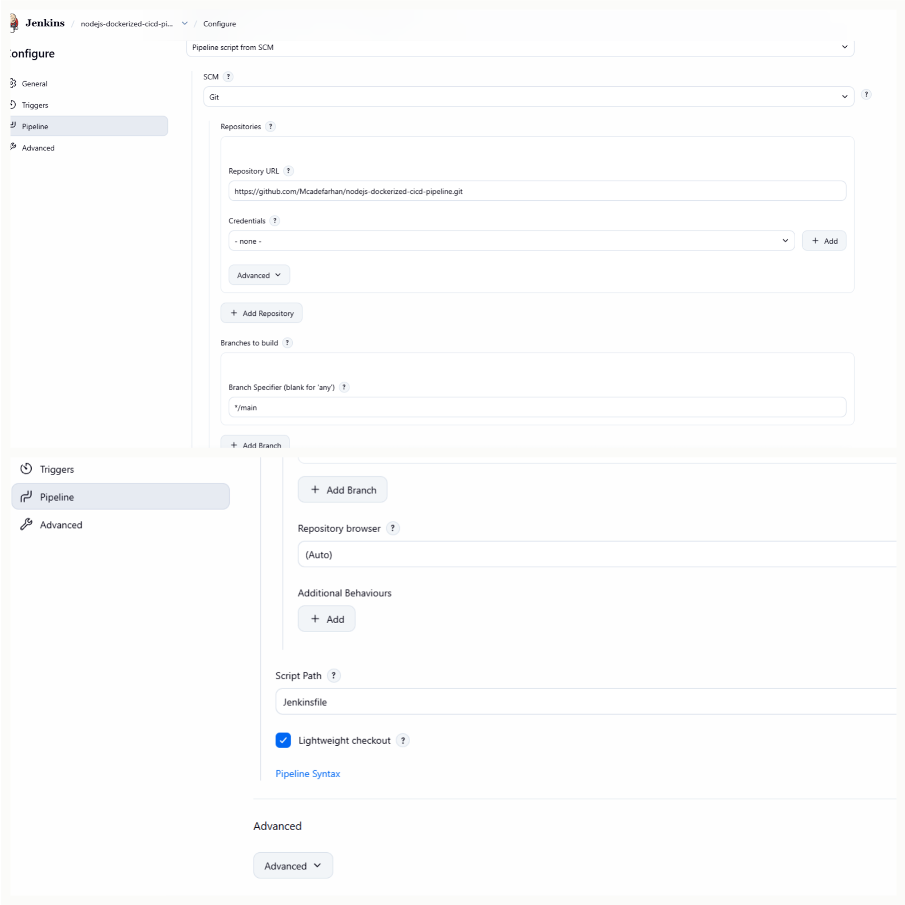

### 6. Build console output

**What this shows:** The end of a successful build log, finishing with `Finished: SUCCESS`. Near the top, the log line `Obtained Jenkinsfile from git` confirms the pipeline came from the repo.

**Why it matters:** The console log is the audit trail of a build. It lets anyone see exactly what ran and debug it when something fails.

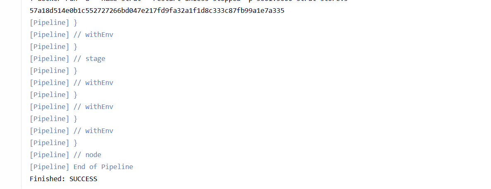

### 7. Automated tests

**What this shows:** The Test stage output showing the Jest and Supertest suite passing (health check, product list, category filter, homepage, product count per category).

**Why it matters:** Tests run before the Docker build. If one fails, the image is never built and nothing is deployed, so broken code cannot reach the server.

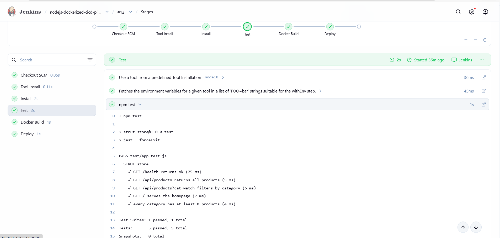

### 8. Running container on EC2

**What this shows:** `docker ps` on the EC2 instance, showing the `strut` container as `Up` and `(healthy)`, with host port 3001 mapped to container port 3000.

**Why it matters:** It confirms the deployed container is alive and that the Docker `HEALTHCHECK` against `/health` is passing.

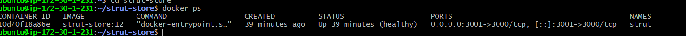

### 9. AWS Security Group

**What this shows:** The inbound rules of the EC2 Security Group, with SSH, Jenkins (8080) and the application port opened to specific sources only.

**Why it matters:** It shows the infrastructure is locked down on purpose and not left open to the whole internet.

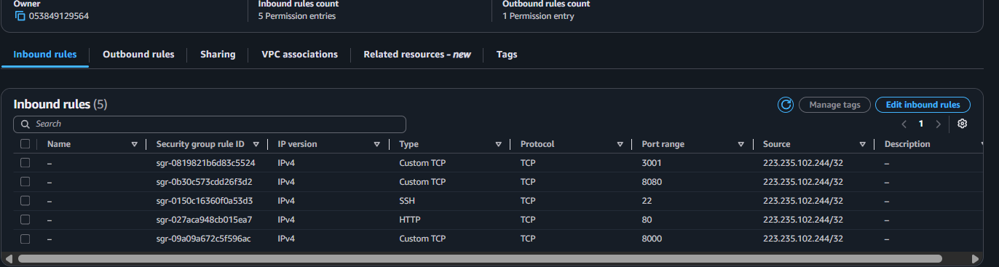

### 10. Automatic build after a commit

**What this shows:** A build that Jenkins started on its own after a push to GitHub, with no one clicking *Build Now*. The build history shows the trigger as an SCM change.

**Why it matters:** This is the core idea of continuous delivery: push code, and it is tested and deployed automatically.

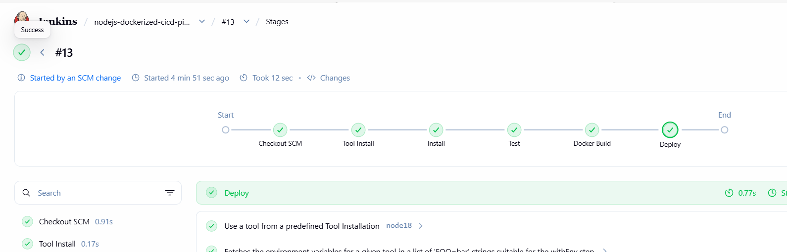

---

## Tech stack

- **Application:** Node.js 18, Express, HTML/CSS/vanilla JS
- **Testing:** Jest, Supertest
- **Containerization:** Docker (`node:18-alpine`)
- **CI/CD:** Jenkins (Declarative Pipeline, NodeJS plugin, Git plugin)
- **Hosting:** AWS EC2 (Ubuntu)
- **Source control:** Git and GitHub

## CI/CD pipeline

The pipeline is defined in [`Jenkinsfile`](./Jenkinsfile):

| # | Stage | What it does | Fails the build when |
|---|---|---|---|
| 1 | **Checkout** | Jenkins pulls the latest commit from `main` | Repo is unreachable |
| 2 | **Install** | `npm install` on the NodeJS 18 tool | Dependency resolution fails |
| 3 | **Test** | `npm test` runs the Jest suite | Any test fails |
| 4 | **Docker Build** | `docker build -t strut-store:<BUILD_NUMBER> .` | Dockerfile or build error |
| 5 | **Deploy** | Removes the old container, starts the new one with `--restart unless-stopped` | Port conflict or container fails to start |

**Trigger:** `pollSCM('H/5 * * * *')`. Jenkins checks GitHub roughly every 5 minutes. A push to `main` reaches production in about 1 to 6 minutes with no manual action.

**Versioning:** every image is tagged with the Jenkins build number (`strut-store:12`), so any build can be traced and rolled back:

```bash
docker rm -f strut
docker run -d --name strut --restart unless-stopped -p 3001:3000 strut-store:<previous-build-number>
```

## Application features

- Product catalogue with category filters (shirts, T-shirts, watches, shoes, chains, caps, accessories)
- Shopping cart drawer with quantity controls and live totals
- Responsive layout (desktop, tablet, mobile)
- Image fallback: if a product photo is missing, an SVG placeholder is shown
- Accessible markup (focus states, ARIA labels, reduced-motion support)

## API reference

| Method | Endpoint | Description |
|---|---|---|
| `GET` | `/health` | Liveness check, returns `{"status":"ok"}`. Used by the Docker `HEALTHCHECK` |
| `GET` | `/api/products` | All products |
| `GET` | `/api/products?cat=watch` | Products filtered by category |

```bash
curl http://localhost:3000/health
curl "http://localhost:3000/api/products?cat=watch"
```

## Project structure

```
.
├── Jenkinsfile            # CI/CD pipeline definition
├── Dockerfile             # Container image definition
├── .dockerignore
├── server.js              # Express app and routes
├── products.js            # Product catalogue data
├── public/                # Frontend (index.html, product images)
├── test/app.test.js       # Jest + Supertest tests
├── tools/fetch-images.js  # Optional helper to download product photos
└── package.json
```

## Run locally

Requires Node.js 18+.

```bash
git clone https://github.com/Mcadefarhan/nodejs-dockerized-cicd-pipeline.git
cd nodejs-dockerized-cicd-pipeline
npm install
npm start          # http://localhost:3000
npm test           # run the test suite
```

## Run with Docker

```bash
docker build -t strut-store .
docker run -d --name strut -p 3001:3000 strut-store
```

Open `http://localhost:3001`. The `-p 3001:3000` flag means host port 3001 maps to container port 3000.

Check container health:

```bash
docker ps          # STATUS should show (healthy)
docker logs strut
```

## Set up the pipeline on EC2

**1. Launch EC2.** Ubuntu, at least `t2.medium` (Jenkins needs about 2 GB RAM or more).

**2. Security Group (inbound).** Restrict by source IP wherever possible.

| Port | Purpose | Source |
|---|---|---|
| 22 | SSH | My IP |
| 8080 | Jenkins UI | My IP |
| 3001 | Application | My IP, or `0.0.0.0/0` for a public demo |

**3. Install prerequisites.**

```bash
sudo apt update && sudo apt install -y git docker.io fontconfig openjdk-17-jre
sudo systemctl enable --now docker
# then install Jenkins following the official Jenkins Debian/Ubuntu guide
sudo usermod -aG docker jenkins && sudo systemctl restart jenkins
```

**4. Configure Jenkins.**

- Install plugins: **Git**, **Pipeline**, **NodeJS**
- *Manage Jenkins > Tools > NodeJS:* add an installation named exactly `node18` (Node 18.x)
- *New Item > Pipeline*, then set **Definition** to *Pipeline script from SCM*
  - SCM: Git, with this repository's URL
  - Branch: `*/main`
  - Script Path: `Jenkinsfile`

**5. Run it.** Click **Build Now** once, then push a commit and watch Jenkins build it automatically.

## Security notes

- The container runs as the non-root `node` user.
- Only production dependencies are installed in the image (`npm install --omit=dev`).
- `.dockerignore` keeps `node_modules`, `.git`, tests and CI files out of the image.
- Jenkins (8080) and SSH (22) are restricted to a single source IP in the Security Group.
- No secrets, keys, or IP addresses are committed to the repository.

## Troubleshooting

Real problems hit while building this project, and their fixes:

| Symptom | Cause | Fix |
|---|---|---|
| `ERR_EMPTY_RESPONSE` / page not loading | Port mapping did not match the app's internal port | Use `-p <host>:<container>` where the container port matches `PORT` (3000) |
| `npm ci` fails: "requires package-lock.json" | Lock file missing from the repo | Commit `package-lock.json`, or use `npm install` |
| Jenkins runs an old pipeline after a push | Job was set to "Pipeline script" instead of SCM | Set **Definition** to *Pipeline script from SCM*. Console log should start with `Obtained Jenkinsfile from git` |
| `Tool type "nodejs" does not have an install of "node18"` | Tool name in Jenkins differs from the Jenkinsfile | Name the NodeJS installation exactly `node18` |
| `Bind for 0.0.0.0:3001 failed: port is already allocated` | A manually started container held the port | `docker rm -f <old-container>`, let the pipeline manage the container |
| `permission denied ... docker.sock` | Jenkins user not in the docker group | `sudo usermod -aG docker jenkins && sudo systemctl restart jenkins` |
| Browser shows "connection refused / timed out" | Security Group missing the app port or source IP changed | Add the inbound rule for 3001 and refresh **My IP** |

## Roadmap

- [ ] Push images to Docker Hub or Amazon ECR and deploy by pulling them
- [ ] GitHub webhook trigger for instant builds instead of polling
- [ ] Slack or email build notifications
- [ ] HTTPS with Nginx reverse proxy and a custom domain
- [ ] Infrastructure as code (Terraform) for the EC2 and Security Group setup
- [ ] Separate staging and production environments

## Author

**Farhan Kalim**
[GitHub](https://github.com/Mcadefarhan) &nbsp;|&nbsp; _add your LinkedIn link_

---

_This is a demo store built to practice and showcase CI/CD. Payments are not connected._ .
